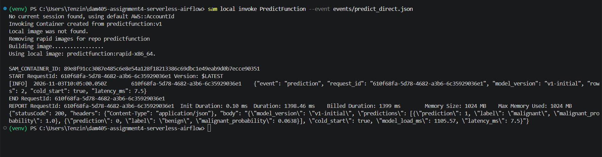
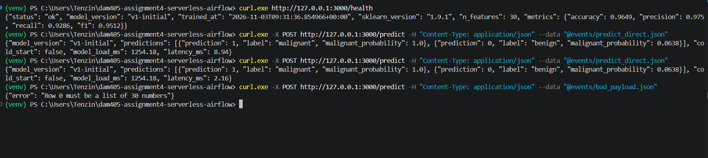
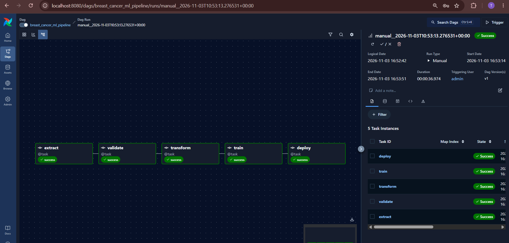
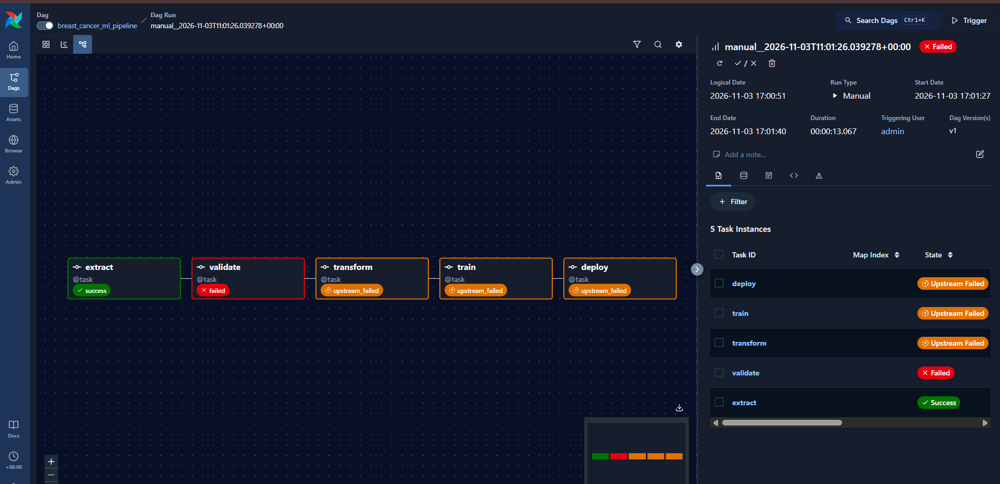

# DAM405 Assignment 4: Serverless Model Deployment and Pipeline Orchestration

Tenzin Namgay (02230307), DAM405 Machine Learning Operations

A breast cancer classifier deployed as an AWS Lambda function behind API Gateway (defined with AWS SAM), and an Apache Airflow DAG that runs the ML pipeline with a Great Expectations data quality gate.

I used **AWS SAM CLI local** as the emulator, not a real AWS account.

## Requirements

* Python 3.12 or newer
* Docker Desktop
* AWS SAM CLI
* Git

## Setup

```powershell
git clone https://github.com/Eyemusican/dam405-assignment4-serverless-airflow.git
cd dam405-assignment4-serverless-airflow
py -m venv venv
venv\Scripts\Activate.ps1
pip install -r requirements.txt
```

## Run the Lambda function

```powershell
python scripts/train_model.py
python scripts/make_events.py
sam validate --lint --region us-east-1
sam build
sam local invoke PredictFunction --event events/predict_direct.json
sam local start-api
```

Then in another terminal:

```powershell
curl.exe http://127.0.0.1:3000/health
curl.exe -X POST http://127.0.0.1:3000/predict -H "Content-Type: application/json" --data "@events/predict_direct.json"
```

## Run the Airflow pipeline

```powershell
docker compose build
docker compose up -d
```

Open http://localhost:8080 and log in as `admin`. Get the password with:

```powershell
docker exec dam405-airflow cat /opt/airflow/simple_auth_manager_passwords.json.generated
```

Unpause `breast_cancer_ml_pipeline` and click Trigger. Set `inject_bad_data` to true to see the quality gate fail.

After a successful run, rebuild Lambda to use the new model:

```powershell
docker compose stop
sam build
sam local invoke PredictFunction --event events/health_api.json
```

To remove the Airflow container when finished:

```powershell
docker compose down
```

## Run the tests

Run `python scripts/train_model.py` first, because the model file is not stored in Git.

```powershell
python -m pytest -v
```

The Great Expectations test is skipped locally. To run it inside the Airflow image:

```powershell
docker run --rm -t -v "${PWD}:/project" -w /project dam405-airflow:3.3.2 bash -c "pip install -q --disable-pip-version-check pytest && python -m pytest -v --color=yes tests/test_pipeline_steps.py"
```

## Main files

* `lambda_fn/app.py`: Lambda handler
* `template.yaml`: SAM template (Infrastructure as Code)
* `dags/breast_cancer_ml_pipeline.py`: Airflow DAG
* `dags/ml_pipeline/steps.py`: pipeline steps
* `docker-compose.yaml`: Airflow setup

## Evidence

All screenshots are in the `evidence/` folder. The key ones:






## References

* Breast Cancer Wisconsin (Diagnostic) dataset, UCI Machine Learning Repository, loaded through scikit learn: https://archive.ics.uci.edu/dataset/17/breast+cancer+wisconsin+diagnostic
* scikit learn: https://scikit-learn.org
* pandas: https://pandas.pydata.org
* joblib: https://joblib.readthedocs.io
* Great Expectations: https://docs.greatexpectations.io
* Apache Airflow documentation: https://airflow.apache.org/docs
* AWS Lambda Developer Guide: https://docs.aws.amazon.com/lambda
* AWS SAM CLI documentation: https://docs.aws.amazon.com/serverless-application-model
* AWS Lambda Python base image: https://gallery.ecr.aws/lambda/python